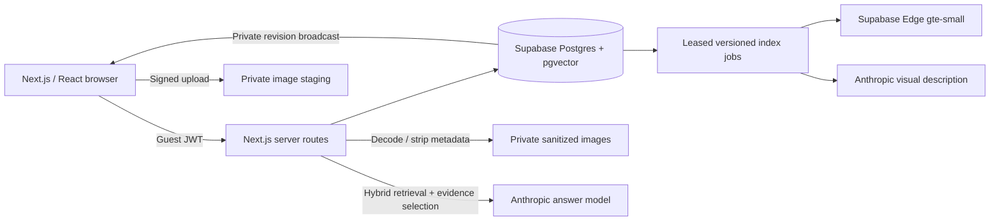

# Memory Box

A little world we leave together. Paint a shared picture, leave an original memory, build on someone else's contribution, and ask the box what connects it all.

**[Open the live commons](https://memory-box-commons.vercel.app)**

Memory Box combines a large sparse collaborative pixel world with an attributed collection of text, images, and links. The canvas is shared; each memory remains its author's original. A response creates a separate memory connected by an explicit “built on” thread.

## Try the loop

1. Open the commons and choose the mixtape, frog pond, or growing garden.
2. Choose **Paint**, draw a preview, then **Add my pixels**. You can also place a small shape. Changes arrive in other visitors' browsers through Supabase Realtime.
3. Leave text, a PNG/JPEG/WebP image, or a link at a chosen place. Give yourself a name if you like.
4. Open someone else's memory and choose **Build on this**. Your contribution gets its own author and a thread back to the original.
5. Use **Find** for exact words or meaning. Try “childhood road trips.”
6. Switch to **Ask**, enter “What do these memories say about music and family?”, then submit with **Ask the box**. The box selects passages in people's own words and shows recorded build-on connections, with links to the originals. A question with insufficient material gets an honest empty answer.

Ten clearly marked fictional starter memories and the initial pixel landmarks make the first visit explorable. They are examples, not evidence of real community activity.

## What is real

- Anonymous Supabase Auth identities persist in the current browser. Ownership is checked on the server and in database transactions.
- The white/pastel world pans freely, supports anchored zoom and mobile pinch, and renders into a viewport-sized canvas. Distant search results become readable pins; opening an original and returning preserves the question, view, scroll position, and source focus.
- Pixel operations are durable and idempotent. Undo restores only cells that a later operation has not changed.
- Realtime broadcasts carry revision metadata. The client refreshes an atomic database snapshot and resynchronizes after reconnecting; a 15-second refresh is the fallback.
- Images upload directly into a private staging bucket. The server decodes, resizes, strips metadata, and re-encodes them to WebP before publication. Unattached staging files never become public.
- Text is immediately searchable. A durable, versioned job describes images and computes embeddings. Postgres full-text search and pgvector candidates are combined with reciprocal-rank fusion.
- Ask lets the model select exact excerpts and relevant recorded connections from at most eight retrieved originals. Code checks each quotation against its selected field and derives all attribution, parent identities and citations from those originals; arbitrary model prose is not published. Machine image descriptions are labeled separately. Selection relevance, excerpt context and the truth of authored memories/image descriptions remain quality limits. Source versions/visibility are checked again after selection; edits/deletions invalidate vectors and open answers.
- Reports, hiding/restoring memories, pausing paint, bounded clearing, and suspending contributors are backed by operator-authorized transactions.

## Architecture



The current embedding namespace is `supabase/gte-small:padded1536`: a normalized 384-dimensional native embedding padded with zeros to fit the common 1536-dimensional storage contract. All candidates are filtered to the same namespace. This is English-oriented search; the cosine cutoff of .80 is provisional and came from a small seed calibration, not a broad retrieval benchmark.

The normal indexing path runs after publishing. Find/Ask requests also give due jobs another opportunity; a daily authenticated cron is the final recovery path. Jobs lease work, retry with backoff, and reject stale source versions. The cron also removes claimed abandoned/deleted private image objects after a 24-hour grace period, while retaining assets referenced by published or hidden originals.

## Run locally

Use Node 22 and a Supabase project. Keep credentials in `.env.local`, which is ignored by Git.

```sh
npm ci
cp .env.example .env.local
# Fill in the project's publishable key, server secret, embedding secret,
# Anthropic key, model names, and a random cron secret.
npm run dev -- --port 3007
```

For a new Supabase project:

```sh
supabase login
supabase link --project-ref YOUR_PROJECT_REF
supabase db push
supabase secrets set --env-file YOUR_PRIVATE_EMBEDDING_SECRET_FILE
supabase functions deploy embed --use-api --no-verify-jwt
npm run seed
```

The private function secret file contains `EMBEDDING_SECRET`, matching the app environment. The function deliberately uses its own strong `x-memory-box-key` authentication; disabling the gateway JWT check does not make it an unauthenticated embedding endpoint. Enable anonymous sign-ins in Supabase Auth. The migrations install the buckets, policies, database functions, and Realtime authorization.

`npm run seed` preserves existing visitor paint and memories on repeat runs. Server credentials belong only in server/CLI environments. Only `NEXT_PUBLIC_SUPABASE_URL` and `NEXT_PUBLIC_SUPABASE_PUBLISHABLE_KEY` go to the browser.

## Validate

```sh
npm test
npm run typecheck
npm run build
npx tsx scripts/test-database.ts
npx tsx scripts/test-database-world-bounds.ts
node --import tsx scripts/test-database-lifecycle.ts
npm run test:e2e
# Opt in to disposable real browser contributions and two provider answers:
MB_E2E_OPEN_WORLD=1 MB_E2E_WRITE=1 MB_E2E_AI=1 npm run test:e2e -- --workers=2
npm run test:live
# Test the deployed server against the same configured project:
TEST_BASE_URL=https://YOUR_DEPLOYMENT npm run test:live
```

Unit tests cover validation, image processing, model boundaries, citation schemas, retrieval fallback, source-version changes, and request origins. Hosted tests exercise real RLS, ordering, idempotency, partial undo, asset eligibility, indexing, ownership, deletion, Realtime, and actual provider calls. Live scripts create disposable fixtures and clean their exact records; run them against a dedicated project or the authorized pilot, never an unrelated database.

The live HTTP script performs model calls and consumes the pilot's normal budgets. It checks citation membership and behavior, not a universal guarantee that every generated sentence is entailed by its source.

The initial release passed 14 live integration checks, including a visual search detail absent from the image author's text, plus six desktop/mobile browser checks. The open-world upgrade adds signed-bounds SQL, camera/brush tests, and opt-in two-visitor browser coverage. See the [build ledger](docs/build-ledger.md) for the scope and limits of this evidence.

## Deploy and operate

Vercel hosts the Next.js app. Configure the environment variables from `.env.example` in its production and preview environments, then deploy with `vercel --prod`. The included cron runs once per day and requires `CRON_SECRET`; do not expose that secret in a browser URL.

`GET /api/health` reports the committed world revision, memory/index counts, and model names. Public Ask is limited to 12 requests per guest per hour and 120 across the pilot per day. Find and Ask share 2,000 native-query reservations per day. Indexing can lease 80 jobs per day; reaching the ceiling leaves due jobs for the next day without burning attempts. Uploads are limited to 60 reservations per day globally and 12 per guest per hour, bounded to 5 MB, and decoded under an image-pixel limit. Edits are limited to 30 per guest per 10 minutes, and unchanged saves avoid reindexing. These are pilot controls; anonymous identities can be recreated and are not a complete abuse defense.

Use the local operator CLI with the server secret to review reports and manage the commons. See `npm run operator -- --help`. Operator authority lives in `profiles.is_operator`, never editable user metadata.

```sh
npm run operator -- profiles
npm run operator -- reports
npm run operator -- grant YOUR_EXISTING_PROFILE_UUID
npm run operator -- hide MEMORY_UUID --actor YOUR_OPERATOR_PROFILE_UUID
```

The CLI also supports restore, pause/resume, bounded paint clearing, contributor suspension, and role revocation. These commands require private local server credentials; the public site cannot grant itself operator access.

The writable pilot plane spans -60000 through 59999 world pixels on each axis, with 6px cells and at most 144 unique cells per paint operation. The original 1200×720 dimensions frame the starter places. Pixels are sparse and the bitmap matches the viewport, but snapshots still transfer all occupied rows; the current implementation is not an unlimited-scale canvas service. Ask searches authored originals and image descriptions; it does not interpret arbitrary painted pixels.

The guest identity lives in browser storage. Clearing that storage or changing devices loses editing access to those memories. Account recovery/linking, larger-scale spatial paging, multilingual retrieval evaluation, automated abuse classification, and a browser operator dashboard are future work.

## Design and evidence

- [Research and revised design](docs/specs/research-and-revised-design.md)
- [Current open-world design and interaction contract](docs/specs/open-world-commons.md)
- [Original visual direction](docs/specs/visual-direction.md)
- [Implementation plan](docs/superpowers/plans/2026-10-20-memory-box-mvp.md)
- [Build ledger](docs/build-ledger.md)

The approved pastel radio asset is in `public/starter-radio.svg`. The current pilot has a guarded administrative refresh tool, `scripts/refresh-starter-radio.ts`: `--prepare` writes a read-only review plan; `--apply <plan>` applies that exact reviewed plan. It is deliberately pinned to the authorized pilot and replaces only original seed-operation cells or absent artwork cells, preserving visitor marks. It records a before/after operation and generates separately reviewed recovery SQL. It is not a general reseed command.

The interface uses white paper, cobalt controls, dark ink, and butter, lilac, blush, peach, and ice memory surfaces. Pixelify accents pair with readable Schibsted body text and compact monospace coordinates. Fonts are self-hosted with their licenses. Pixel landmarks and paper-like memories carry the personality; the navigation stays quiet so the shared world remains the focus.
